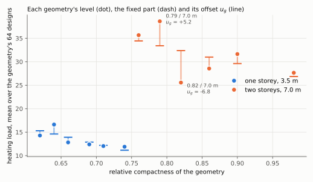
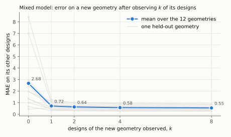

# 01 · The linear mixed-effects model, and how it predicts a building geometry it has never seen

*Part of [models that use the grouping](README.md). The model is the "mixed effects" arm of [`02_grouped_structure.ipynb`](../../02_grouped_structure.ipynb), implemented in `fit_predict_mixed` in [`helper.py`](../../helper.py); its headline results are on the [results page](../results/02-grouped-structure.md). The numbers this note adds, and its figures, come from [`figures/make_figures.py`](figures/make_figures.py), which saves them in [`figures/numbers.json`](figures/numbers.json).*

A linear mixed-effects model is ordinary linear regression with one extra idea: the rows come in groups, and each group is allowed its own offset, drawn from a distribution whose spread the model estimates. That one idea changes three things at once. It changes how confident the model is about effects that vary between groups, it lets the model say how far off it can be for a group it has never seen, and it gives a principled way to correct the prediction for a new group as soon as a few of its rows are observed. This note builds the model up from the table it is used on, fits it, reads every number it returns, and follows one prediction for an unseen building geometry from the formula to the final band.

---

## 1. The table is made of groups

The UCI Energy Efficiency table holds 768 simulated residential buildings. Each building is one combination of three design choices:

- one of 12 **geometries**, each described by five shape columns: relative compactness, surface area, wall area, roof area and overall height. Six geometries are two storeys tall (7.0 m) and six are one storey (3.5 m). All twelve enclose the same volume, arranged differently;
- one of 4 **orientations**;
- one of 16 **glazing setups**: no windows, or a window area of 10%, 25% or 40% of the floor area spread over the facades in one of five ways, which the table codes as the glazing distribution 1 to 5.

Every combination appears exactly once, so each geometry is a group of $4 \times 16 = 64$ designs that share their five shape columns. The target is the simulated heating load, the energy needed to keep the building warm, in kWh per square metre. It runs from about 6 to 43.

The grouping dominates the target. The mean heating load of each geometry, which this note calls the geometry's **level**, explains 91% of the variance across all 768 designs, and the level plus one shift per glazing setup explains 99%. Two designs of the same geometry are therefore very similar, and two designs of different geometries can be far apart even when their glazing is the same. In the notation used below, the fraction of variance that two designs of one geometry share is the **intraclass correlation** $\rho$, here 0.914. The [results page](../results/02-grouped-structure.md) turns that into an effective sample size: for anything that varies between geometries, the 768 designs carry about the information of 13 independent ones, because 64 near-copies of one geometry say little more about geometries in general than one copy does.

The question this note cares about is the hard one. When a geometry is absent from the data the model learns from, how well can its heating loads be predicted, and how honestly can the model say how uncertain that prediction is? Notebook 02 answers it by **leaving one geometry out**: a model is fitted on the other eleven geometries, 704 designs, and predicts all 64 designs of the twelfth. Every geometry takes its turn.

---

## 2. Three ways to treat the grouping

Before the model itself, it helps to see the two extremes it sits between. Suppose the design columns that describe a building are collected in a row vector $x_{gi}$ for design $i$ of geometry $g$, and the heating load is $y_{gi}$.

**Complete pooling ignores the groups.** Ordinary least squares fits $y_{gi} = x_{gi}^\top \beta + \varepsilon_{gi}$, one coefficient vector $\beta$ for everything and one residual $\varepsilon_{gi}$ per design, and treats all 768 residuals as independent. It can predict a new geometry, since it only needs the geometry's columns, but it misjudges how much it knows. The residuals of one geometry are not independent: they share whatever the shape columns fail to explain about that geometry. Least squares counts 768 independent pieces of evidence where, for the shape effects, there are only twelve. On this table its residual standard deviation is 2.85, a mixture of between-geometry and within-geometry error that it cannot tell apart.

**No pooling gives every group its own intercept.** Adding one indicator column per geometry absorbs everything the groups do not share. The residual standard deviation falls to 0.65, which is the scatter of designs around their own geometry. But this model has nothing to say about a new geometry: its intercept is a free parameter estimated from that geometry's own rows, and a geometry left out has none.

**Partial pooling, the mixed model, treats the group intercepts as draws from a population.** Each geometry still gets its own offset, but the offsets are modelled as coming from one normal distribution with a spread the model estimates. A geometry with many rows gets an offset close to what its own rows say; a geometry with few rows is pulled towards the population; and a geometry with no rows at all gets the population's centre, zero, together with the population's spread as its uncertainty. That last case is exactly the unseen geometry.

---

## 3. The model

For design $i$ of geometry $g$, the linear mixed-effects model with a random intercept is

$$
y_{gi} = x_{gi}^\top \beta + u_g + \varepsilon_{gi}, \qquad u_g \sim \mathcal{N}(0, \tau^2), \qquad \varepsilon_{gi} \sim \mathcal{N}(0, \sigma^2),
$$

with every $u_g$ and every $\varepsilon_{gi}$ independent of each other and of $x_{gi}$. The pieces are:

| Symbol | Name | Meaning here |
|---|---|---|
| $y_{gi}$ | response | heating load of design $i$ of geometry $g$ |
| $x_{gi}$ | fixed-effect covariates | the design's columns that enter the formula: compactness, height, glazing area, glazing area times height, glazing distribution and orientation |
| $\beta$ | fixed effects | one coefficient per covariate, shared by all geometries |
| $u_g$ | random effect | geometry $g$'s own offset: how far its level sits from what its shape columns predict |
| $\tau^2$ | between-group variance | how much the offsets $u_g$ vary from geometry to geometry |
| $\varepsilon_{gi}$ | residual | what is left for one design after its geometry's offset |
| $\sigma^2$ | within-group variance | how much designs scatter around their geometry |

The word "fixed" for $\beta$ and "random" for $u_g$ is historical and slightly misleading. Both are unknown quantities. The difference is that $\beta$ is a set of individual parameters to be estimated, while the $u_g$ are treated as a sample from a distribution, and what is estimated is that distribution's variance $\tau^2$. This is what lets the model speak about geometries outside the sample: it has learned not a list of twelve offsets but how big offsets tend to be.

**The formula used here.** In the formula notation statsmodels uses, the fixed part is

```
heating_load ~ relative_compactness + overall_height + glazing_area
               + glazing_area:overall_height + C(glazing_distribution) + C(orientation)
```

Compactness and height describe the geometry. Only two of the five shape columns are used because the five are nearly redundant across twelve geometries: compactness and surface area, for instance, correlate at $-0.99$. Glazing area enters as a number, and `glazing_area:overall_height` lets windows matter more on a taller building, whose facade is larger. `C(...)` turns a column into indicator variables, one per category beyond a reference category: distribution 0, which only occurs with no windows, and orientation 2.

**What the model says about variance.** Under the model, the variance of a design's heating load around its fixed part is $\tau^2 + \sigma^2$, and the covariance between two different designs of the same geometry is $\tau^2$, because they share $u_g$ and nothing else. Two designs of different geometries are uncorrelated. The share of the remaining variance that sits between geometries is

$$
\rho_{x} = \frac{\tau^2}{\tau^2 + \sigma^2},
$$

the **conditional intraclass correlation**, conditional because it is computed after the fixed part has explained what it can. On the full table it is 0.961, higher than the raw 0.914 of section 1. The fixed part explains the glazing setups, which are a within-geometry source of variation, so what remains is even more dominated by the geometries.

---

## 4. How the model is fitted

**Integrating out the offsets.** The offsets $u_g$ are never observed, so the model is fitted through the distribution of the observed data with the offsets averaged out. Stack the $n_g$ designs of geometry $g$ into a vector $y_g$ and their covariate rows into a matrix $X_g$. Then

$$
y_g \sim \mathcal{N}\left(X_g \beta, V_g\right), \qquad V_g = \sigma^2 I_{n_g} + \tau^2 \mathbf{1}\mathbf{1}^\top,
$$

where $I_{n_g}$ is the $n_g \times n_g$ identity matrix and $\mathbf{1}$ is a vector of $n_g$ ones, so $\mathbf{1}\mathbf{1}^\top$ is a matrix of ones. Every design has variance $\sigma^2 + \tau^2$, every pair within the geometry has covariance $\tau^2$, and different geometries are independent. Fitting means choosing $\beta$, $\tau^2$ and $\sigma^2$ to make this distribution likely for the data.

**The fixed effects, given the variances.** For known $\tau^2$ and $\sigma^2$, the best estimate of $\beta$ is generalized least squares,

$$
\hat\beta = \left( \sum_g X_g^\top V_g^{-1} X_g \right)^{-1} \sum_g X_g^\top V_g^{-1} y_g ,
$$

which is least squares weighted by the inverse of the covariance. In words: when the rows of a geometry are strongly correlated, they count as less than $n_g$ independent rows for the effects that differ between geometries, and as more than that for effects that differ within a geometry, since the shared offset cancels in within-geometry contrasts.

**The variances: REML rather than plain maximum likelihood.** Plain maximum likelihood estimates $\tau^2$ as if $\beta$ were known exactly. It is not, and the between-geometry part of $\beta$, the intercept and the coefficients of compactness and height, is estimated from the same twelve geometries that inform $\tau^2$. Using three of the twelve geometries' worth of information on $\beta$ leaves about nine for $\tau^2$, and maximum likelihood ignores this, so it underestimates $\tau^2$. Restricted maximum likelihood, REML, maximizes the likelihood of the part of the data that does not depend on $\beta$ and corrects for it. On the full table the two give $\tau = 2.78$ under maximum likelihood and $\tau = 3.21$ under REML; the ratio, 1.155, is almost exactly $\sqrt{12/9}$, the degrees-of-freedom correction described above. With few groups this difference matters, and notebook 02 uses REML.

**A balanced table makes the coefficients easy and the standard errors interesting.** Because every geometry contains every glazing setup and orientation exactly once, the generalized least squares coefficients here coincide with those of ordinary least squares. What differs, sharply, is how certain each coefficient is:

| Coefficient | Estimate | Standard error, least squares | Standard error, mixed model |
|---|---|---|---|
| relative compactness | −34.53 | 1.75 | 15.62 |
| overall height, per metre | 6.06 | 0.15 | 0.94 |
| glazing area | −0.82 | 2.50 | 0.56 |
| glazing area × height | 3.37 | 0.45 | 0.10 |
| glazing distribution 1, against no windows | 4.53 | 0.53 | 0.12 |
| orientation 3, against 2 | 0.07 | 0.29 | 0.07 |

The two kinds of coefficient move in opposite directions. **Between-geometry effects** are learned from twelve geometries, and least squares, which counts 768 rows, is about nine times too confident about compactness and six times about height. **Within-geometry effects** are learned by comparing designs inside each geometry, where the offset cancels, and least squares, which leaves the large between-geometry variance in its residual, is about four and a half times too unsure about them. Both errors come from the same mistake of treating grouped rows as independent; the mixed model corrects both by putting the variance where it belongs.

---

## 5. Reading the fitted model

On all twelve geometries, the REML fit gives:

- **Glazing.** Having windows at all adds about 4.2 to 4.5 units, the coefficient of distribution 1 to 5 against no windows, and the area then adds $-0.82 + 3.37 \times h$ per unit of glazing area for a building of height $h$ metres: 11.0 per unit on a one-storey building and 22.7 on a two-storey one. Going from no windows to 40% glazing with distribution 1 therefore adds about 8.9 units at 3.5 m and 13.6 at 7.0 m.
- **Orientation** does nothing measurable: its three coefficients are all below 0.07 in size, each within about one standard error of zero.
- **Shape.** At fixed height, more compact buildings need less heat, $-34.5$ per unit of compactness, and a second storey adds 6.1 per metre. Both are learned from twelve points that are not independent of each other: compactness and height correlate at 0.83 across the geometries. The large standard error on compactness says the data cannot separate their effects well.
- **The two variances.** $\tau = 3.21$ and $\sigma = 0.65$. Once the shape and glazing are accounted for, a geometry's own offset typically moves all its designs by about three units, while designs scatter around their geometry by well under one. The estimate of $\tau^2$, 10.3, has a standard error of 7.6: twelve geometries determine the between-geometry variance only roughly.

**The estimated offsets.** For the geometries in the data, the model also returns an estimate $\hat u_g$ of each offset, the best linear unbiased predictor (BLUP). Writing $\bar r_g$ for the mean residual of geometry $g$'s designs after the fixed part, $\bar r_g = \frac{1}{n_g}\sum_i (y_{gi} - x_{gi}^\top\hat\beta)$, the estimate is

$$
\hat u_g = \frac{\tau^2}{\tau^2 + \sigma^2 / n_g} \bar r_g .
$$

The fraction in front is the **shrinkage factor**. It compares two variances: $\tau^2$, how much offsets vary between geometries, and $\sigma^2/n_g$, how noisy the mean of $n_g$ designs is. When a geometry has many designs, the factor is close to 1 and the estimate is simply the geometry's mean residual. When it has few, the factor falls and the estimate is pulled towards zero, the population's centre, because a mean of a few noisy designs is not to be trusted on its own. Here $n_g = 64$ and the factor is 0.9994: with 64 designs per geometry there is essentially nothing to shrink. Shrinkage becomes the central behaviour when groups are small, as in section 8.



The figure shows what the offsets are. Each dot is a geometry's level, its mean over 64 designs; each dash is the fixed part averaged over the same 64 designs; the line between them is $\hat u_g$. On the one-storey geometries, to the left, the fixed part tracks the levels within about two units. On the two-storey geometries the levels do not change smoothly with compactness: the 0.82 geometry sits 6.8 units below the fixed part, about $-2.1\tau$, and its neighbour at 0.79 sits 5.2 above, about $+1.6\tau$. These two geometries differ in level by 13 units while their shape columns differ only slightly. A linear function of compactness and height cannot represent that, and the model puts the difference into the offsets.

---

## 6. Predicting a design of an unseen geometry

**The prediction.** For a design of a geometry outside the data, the model's equation still holds, $y = x^\top\beta + u + \varepsilon$, but nothing in the data says anything about this geometry's $u$. Its distribution is the population's, $\mathcal{N}(0, \tau^2)$, so the best prediction of $u$ is zero and the prediction of the heating load is the fixed part alone, $\hat y = x^\top \hat\beta$. The mixed model, on its own, predicts a new geometry no better than least squares with the same columns would; in this balanced table the two predictions are identical.

**The uncertainty is where the model earns its place.** The predictive variance for one design of a new geometry is

$$
\mathrm{Var}(y - \hat y) = \tau^2 + \sigma^2 + x^\top \mathrm{Cov}(\hat\beta) x ,
$$

the variance of the unknown offset, plus the design's own scatter, plus the uncertainty of the estimated fixed part at this design. The band in notebook 02 uses the first two terms: its 80% band is $\hat y \pm 1.2816 \sqrt{\tau^2 + \sigma^2}$, where 1.2816 is the 90% quantile of the standard normal distribution, so that 10% falls below the band and 10% above. With $\tau = 3.21$ and $\sigma = 0.65$ that is about $\pm 4.2$, a band 8.4 wide, and nearly all of it comes from $\tau$. Least squares would give a band of similar width from its residual standard deviation, 2.85, but it would describe that width as scatter around a known level, which is wrong for designs of one geometry: their errors are not independent draws, they move together.

**A worked example.** Take the fold that holds out the geometry with compactness 0.86 and height 7.0 m, and its design E0297: orientation 2, 25% glazing area, distribution 1, true heating load 29.54. Fitted on the other eleven geometries, the model's coefficients are 8.257 for the intercept, 4.471 for distribution 1, 0 for orientation 2 (the reference), $-33.948$ for compactness, 6.133 for height, $-1.359$ for glazing area and 3.537 for glazing area times height. The fixed part is

$$
8.257 + 4.471 - 33.948 \times 0.86 + 6.133 \times 7.0 - 1.359 \times 0.25 + 3.537 \times 0.25 \times 7.0 = 32.31 .
$$

The fold's variances are $\tau = 3.27$ and $\sigma = 0.64$, so the band is $32.31 \pm 1.2816 \times \sqrt{3.27^2 + 0.64^2} = 32.31 \pm 4.27$, from 28.04 to 36.58. The truth, 29.54, lies inside it, and the prediction is 2.77 too high. That error is mostly this geometry's offset: on the full table, $\hat u_g$ for the 0.86 geometry is $-2.43$, and every design of the geometry inherits it. The other 63 designs of the geometry are predicted too high by a similar amount, which is why per-geometry errors in notebook 02 are close to a constant shift.

**The term the band leaves out.** The third term of the predictive variance is not small here. Averaged over each held-out geometry's designs, the standard error of the fixed part ranges from 1.0 to 3.8 across folds, and it is largest at the edges of the shape range: 3.8 for the most compact geometry, 0.98, whose compactness lies outside the other eleven, and 2.6 for the 0.76 geometry, the last two-storey shape. Including it would widen the band most where the model extrapolates. It would not rescue the geometries the model misses most, as the next section shows: on the 0.82 and 0.79 geometries the fixed part's standard error is only 1.0 and 1.6.

---

## 7. Over all twelve geometries

Held out one at a time, the mixed model's predictions have a mean absolute error (MAE) of 2.68 over all 768 designs and an $R^2$ of 0.870, the best point accuracy of the six arms in notebook 02. TabPFN-3.5 scores 2.92 and XGBoost 4.97, and over twelve geometries none of these differences is resolved. Per geometry:

| Geometry | 0.98 / 7.0 m | 0.90 | 0.86 | 0.82 | 0.79 | 0.76 | 0.74 / 3.5 m | 0.71 | 0.69 | 0.66 | 0.64 | 0.62 |
|---|---|---|---|---|---|---|---|---|---|---|---|---|
| MAE | 1.97 | 2.60 | 2.93 | 8.42 | 7.00 | 1.97 | 1.00 | 0.44 | 0.66 | 1.33 | 2.51 | 1.34 |

**The error is the level, not the designs.** Subtract each geometry's mean error from its designs' errors and the MAE that remains, the error in ranking designs within a geometry, is 0.51 on average. Almost all of the 2.68 is the misplaced level, which is what the model predicts: for an unseen geometry, it can learn the glazing and orientation effects from the other geometries, but the offset $u_g$ is unknowable.

**The band is right on average and wrong on whole geometries.** The 80% band covers 83% of all designs, close to nominal, and it covers at least 80% of the designs on ten of twelve geometries. On the 0.82 and the 0.79 geometries it covers none. Their offsets, $-2.1\tau$ and $+1.6\tau$ on the full table, already sit outside the band's central $\pm 1.28\tau$ for the offset, and in the folds that hold them out the situation is worse: $\tau$ estimated without the 0.82 geometry is 2.10, and without the 0.79 geometry 2.65, against 3.27 to 3.40 in every other fold. Removing the most surprising geometry removes the evidence that geometries can be that surprising. With twelve groups, the between-group variance is learned from very few examples of the thing it is meant to describe, and the band is narrowest exactly where it is most needed.

---

## 8. Which comparisons the estimates support

The decomposition into $\tau$ and $\sigma$ answers a practical question directly: how far apart must two predicted heating loads be before the difference can be trusted?

- **Two designs of the same geometry**, for instance the same building with 10% or with 40% glazing. Both predictions carry the same unknown offset, and it cancels in their difference. What is left is the two designs' own scatter, with standard deviation $\sqrt{2}\sigma = 0.91$. A predicted difference of a few units between glazing choices on one geometry is meaningful even when the geometry itself is new.
- **Two designs of two different new geometries.** Each carries its own unknown offset, and the offsets do not cancel. The standard deviation of the difference is $\sqrt{2(\tau^2 + \sigma^2)} = 4.63$. A predicted difference of three units between two unbuilt building forms is well within what the offsets alone can produce.

The same prediction can be reliable for one decision and unreliable for another, and the model says which.

---

## 9. After observing a few designs of the new geometry

The shrinkage formula of section 5 also answers a question that matters in practice: what changes once a few designs of the new geometry have been simulated? Suppose $k$ of its designs are observed, with mean residual $\bar r$ after the fixed part. The offset's estimate is

$$
\hat u = \frac{\tau^2}{\tau^2 + \sigma^2 / k} \bar r ,
$$

and every other design of the geometry is predicted as $x^\top\hat\beta + \hat u$. With $\tau = 3.21$ and $\sigma = 0.65$, the factor is already 0.96 at $k = 1$: a single observed design reveals almost the whole offset, because the offset is large compared with how much one design scatters around it. No refitting is needed; $\hat\beta$, $\tau$ and $\sigma$ come from the other eleven geometries.



The figure applies this to every fold. For each held-out geometry, $k$ designs are drawn at random, the offset is estimated from them with that fold's $\hat\beta$, $\tau$ and $\sigma$, and the MAE is measured on the geometry's other $64 - k$ designs, averaged over 200 random draws. Averaged over the twelve geometries, the MAE falls from 2.68 with no observed design to 0.72 with one, 0.64 with two, 0.58 with four and 0.55 with eight. The two geometries the model missed by 8.4 and 7.0 fall to 1.27 and 0.98 after one design. The floor, around 0.5, is the within-geometry error of section 7, which no amount of information about the offset can remove. This is an illustration computed for this note, not an entry in the results ledger, where the question is open for TabPFN as well.

The point generalizes. When most of the variance is between groups and a new group is unpredictable from its descriptors, the most valuable data for a new group is a little data from that group.

---

## 10. What the model assumes, and where those assumptions bend here

- **Offsets are normal and independent of the covariates.** The model treats each $u_g$ as a fresh draw from $\mathcal{N}(0, \tau^2)$, unrelated to shape. Geometries that are similar in shape are not expected to have similar offsets. That assumption costs little for an unseen geometry, since it gets offset zero either way, but it means the band has the same width for a geometry in the middle of the shape range as for one at its edge. A model whose offsets are correlated according to shape, which is what the [two-stage model](02-two-stage.md) approximates, would widen the band away from known geometries.
- **One between-group variance for all geometries.** The 0.82 and 0.79 geometries are not draws from the same normal distribution as the others in any useful sense; they are a pair whose levels jump. Twelve groups cannot reveal whether the offset distribution has heavier tails than a normal.
- **Only the intercept varies.** The glazing effect is assumed identical across geometries of one height. The 99% explained by level plus glazing shift says this is very nearly true here. Where it is not, a random slope adds a geometry-specific glazing effect with its own variance, `re_formula="~glazing_area"` in statsmodels.
- **Few groups.** Everything that varies between geometries, the shape coefficients and $\tau$, is learned from eleven or twelve points. The model reports this honestly in its standard errors, but it cannot overcome it.

---

## 11. In code

```python
import statsmodels.formula.api as smf

fit = smf.mixedlm(
    "heating_load ~ relative_compactness + overall_height + glazing_area"
    " + glazing_area:overall_height + C(glazing_distribution) + C(orientation)",
    data=history,                    # the eleven context geometries
    groups=history["geometry"],      # one random intercept per geometry
).fit(reml=True)

tau2 = fit.cov_re.iloc[0, 0]         # between-geometry variance, tau squared
sigma2 = fit.scale                   # within-geometry variance, sigma squared
offsets = fit.random_effects         # estimated u_g for each context geometry
fixed_part = fit.predict(current)    # x . beta_hat: the prediction for an unseen geometry
```

`fit.predict` uses the fixed effects only, which is the right prediction for a geometry outside the data. For a geometry in the data, adding its entry of `fit.random_effects` gives the prediction that includes its estimated offset. `fit.summary()` prints the coefficients with their standard errors and the estimated group variance as "Group Var".

---

**Next:** [02 · The two-stage model](02-two-stage.md) models the same structure differently: it predicts each geometry's level as a smooth function of its shape, and then adds the within-geometry glazing shift.
