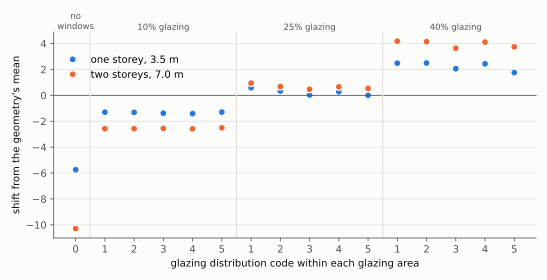

# 02 · The two-stage model: a geometry's level from its shape, plus the glazing shift

*Part of [models that use the grouping](README.md). The model is the "two-stage" arm of [`02_grouped_structure.ipynb`](../../02_grouped_structure.ipynb), implemented in `fit_predict_two_stage` in [`helper.py`](../../helper.py); its headline results are on the [results page](../results/02-grouped-structure.md). The numbers this note adds, and its figures, come from [`figures/make_figures.py`](figures/make_figures.py), which saves them in [`figures/numbers.json`](figures/numbers.json). The [previous note](01-mixed-effects.md) describes the table and the leave-one-geometry-out evaluation in detail; this one assumes them.*

The [mixed-effects model](01-mixed-effects.md) describes the heating load with one linear formula and lets each geometry carry an offset that the formula cannot explain. The two-stage model takes the structure of the table more literally. The data say that a building's heating load is almost entirely its geometry's level plus a shift that depends on its glazing, so the model predicts those two pieces separately, each with the tool that suits it, and adds them. The level of a new geometry is predicted from its shape by a Gaussian process fitted to one number per known geometry. The shift is read from a table of how far each glazing setup sits above or below its geometry's level. This note builds both stages, follows the same worked example as the previous note, and looks at where the model is excellent, where it fails, and what its uncertainty means.

---

## 1. The decomposition the data suggest

Write the heating load of design $i$ of geometry $g$ as

$$
y_{gi} = L_g + s(c_{gi}) + e_{gi},
$$

where:

- $L_g$ is the **level** of geometry $g$, the mean heating load over its 64 designs;
- $c_{gi}$ is the design's **cell**: its overall height, glazing area and glazing distribution. Height is fixed by the geometry; the glazing area and distribution vary within it. There are 16 glazing setups for each of the two heights, so 32 cells;
- $s(c)$ is the **shift** of cell $c$: how far designs with this height and glazing setup sit above or below their own geometry's level;
- $e_{gi}$ is what is left: orientation, which matters very little, and any way a glazing setup's effect differs between geometries of the same height.

This decomposition is not an assumption made for convenience. The geometry levels alone explain 91% of the heating-load variance across the 768 designs, and the levels plus one shift per glazing setup explain 99%, as the [results page](../results/02-grouped-structure.md) records. The two-stage model is that 99% turned into a predictor. Orientation is left out of the cell because its effects, as the mixed model measured them, are all smaller than 0.07 units.

The difficulty is only in $L_g$. A new geometry's shift can be read off the other geometries, because every geometry contains the same glazing setups. Its level cannot be observed; it has to be predicted from the five shape columns.

---

## 2. Stage 2: the shift table

The second stage is the simpler one and is described first. From the context geometries, compute each design's deviation from its own geometry's level, and average those deviations within each cell:

$$
\hat s(c) = \frac{1}{\left|\mathcal{D}_c\right|} \sum_{(g,i) \in \mathcal{D}_c} \left( y_{gi} - \bar y_g \right),
$$

where $\mathcal{D}_c$ is the set of context designs in cell $c$, $\left|\mathcal{D}_c\right|$ is their number, and $\bar y_g$ is the mean heating load of geometry $g$ over its 64 designs. With one geometry held out, a cell holds 4 orientations times the 5 or 6 context geometries of that height, so 20 or 24 designs.



The figure shows the table computed on all twelve geometries. On a one-storey building, having no windows puts a design 5.7 units below its geometry's level and 40% glazing about 1.8 to 2.5 above it, a range of about 8 units. On a two-storey building the same range runs from 10.3 below to 3.6 to 4.2 above, about 14 units. This is why height is part of the cell: a glazing setup's effect is roughly twice as large on the taller buildings, whose facades are larger. Within a glazing area, the five distributions differ by less than one unit.

Two properties of the table make this stage work so simply.

- **The design is balanced.** Every geometry contains every glazing setup, so every geometry's level is an average over the same mix of setups, and deviations from different geometries' levels are directly comparable. If some geometries had been simulated only with large windows, their level would be inflated by their glazing, and the levels and shifts would have to be estimated jointly, for example by a regression with one indicator per geometry.
- **The shift is nearly the same for all geometries of a height.** After the shift, the remaining design-level spread has a standard deviation between 0.52 and 0.59 across the twelve folds, close to the mixed model's $\sigma$ of 0.65.

---

## 3. Stage 1: the geometry's level from its shape

The first stage has to predict a number for a geometry from its five shape columns, having seen eleven examples. That is regression with eleven data points, one per context geometry:

$$
\left( z_g, \bar y_g \right), \qquad g = 1, \dots, 11,
$$

where $z_g$ is the vector of geometry $g$'s five shape columns: relative compactness, surface area, wall area, roof area and overall height. Each column is standardized over the eleven context geometries, so that every column has mean 0 and standard deviation 1 and the columns are measured on comparable scales.

### Gaussian process regression, briefly

A Gaussian process treats the unknown function $L(z)$, the level as a function of shape, as random, and describes it by how strongly its values at two shapes are correlated. That is the **kernel** $k(z, z')$, the covariance between $L(z)$ and $L(z')$. The kernel used here is

$$
k(z, z') = \eta^2 \exp\left( -\frac{1}{2} \sum_{j=1}^{5} \frac{(z_j - z'_j)^2}{\ell_j^2} \right) + w \delta(z, z'),
$$

where:

- $\eta^2$ is the **signal variance**: how far the levels range from their average;
- $\ell_j$ is the **length scale** of shape column $j$: how far apart two geometries must be in that column, in standardized units, before their levels stop being similar. A short length scale makes the column decisive; a very long one makes the function flat along it, so the column is effectively ignored. Having one length scale per column is called automatic relevance determination;
- $w$ is the **noise variance**, and $\delta(z, z')$ is 1 when the two inputs are the same data point and 0 otherwise. It lets the observed levels differ from a smooth function of shape, and section 4 shows that its role here is larger than the word "noise" suggests.

The levels are centred and scaled before fitting, so the process's prior mean is the average context level. Given the eleven levels $\bar y$ stacked in a vector, the prediction for a new shape $z_{\ast}$ is a normal distribution with mean and variance

$$
\mu(z_{\ast}) = m + k_{\ast}^\top \left( K + w I \right)^{-1} \left( \bar y - m \mathbf{1} \right), \qquad
v(z_{\ast}) = \eta^2 + w - k_{\ast}^\top \left( K + w I \right)^{-1} k_{\ast} ,
$$

where $m$ is the average context level, $\mathbf{1}$ is a vector of ones, $K$ is the $11 \times 11$ matrix of smooth-kernel values between the context geometries, $k_{\ast}$ is the vector of smooth-kernel values between $z_{\ast}$ and each context geometry, and $I$ is the identity matrix. The mean is a weighted combination of the context levels, weighted by how similar each context geometry is to the new one under the kernel. The variance starts at the prior variance $\eta^2 + w$ and is reduced by however much the nearby context geometries pin the function down. Far from all context geometries, $k_{\ast}$ is nearly zero, the prediction returns to the average level, and the variance returns to the prior variance.

The hyperparameters $\eta^2$, $\ell_1, \dots, \ell_5$ and $w$ are chosen by maximizing the marginal likelihood of the eleven levels, with five random restarts of the optimizer. That is seven hyperparameters set from eleven numbers, which section 4 shows is a real limitation.

### Putting the stages together

For a design of the held-out geometry with shape $z_{\ast}$ and cell $c$, the two-stage prediction is

$$
\hat y = \mu(z_{\ast}) + \hat s(c),
$$

and its 80% band is $\hat y \pm 1.2816 \sqrt{v(z_{\ast}) + r^2}$, where $r$ is the standard deviation of the stage-2 residuals and 1.2816 is the 90% quantile of the standard normal distribution. The two variances add because the level and the design's residual are treated as independent.

---

## 4. What the Gaussian process learns

The fitted length scales show which shape columns the process uses, and they are surprisingly consistent in most folds:

- **Height acts as a switch.** In eleven of the twelve folds, the length scale for height is at or near its lower bound, at most 0.08 in standardized units, while one-storey and two-storey geometries are about 2 standardized units apart. The kernel therefore treats the two heights as unrelated: in effect, the process fits one curve for one-storey geometries and an independent one for two-storey geometries.
- **Wall area carries the rest.** In those eleven folds the wall-area length scale is between 2 and 5, a gentle trend, while compactness, surface area and roof area mostly get length scales in the thousands or more, up to the upper bound of $10^5$, which switches them off. In the fold that holds out the 0.82 geometry, surface area is also used.
- **The exception is the fold without the 0.79 geometry.** There the process switches off height and wall area and uses roof area with a short length scale of 0.57, together with compactness and surface area. Roof area also separates the two heights, since every one-storey geometry has a larger roof than every two-storey one, so the change of columns is less dramatic than it looks, but the prediction changes a lot, as section 6 shows.

Why wall area? Among the two-storey geometries, wall area takes only four values: 294 for the 0.98 and 0.86 geometries, 318.5 for the 0.90 and 0.82 geometries, 343 for the 0.79 geometry and 416.5 for the 0.76 geometry. Among the one-storey geometries it rises steadily with decreasing compactness. Under a kernel built on height and wall area, two geometries with the same wall area and height are the same input, and the process has to explain their different levels as noise.

**The noise term is the process's version of an offset.** That is the most useful thing to notice about the fit. The 0.90 and 0.82 geometries share their wall area and height, but their levels are 31.6 and 25.6. The process cannot fit both with a smooth function of its inputs, so it raises $w$. Translated back to heating-load units, the noise standard deviation is between 3.0 and 3.3 in ten folds. That is almost exactly the mixed model's between-geometry standard deviation $\tau$, which is 3.3 to 3.4 in the same folds, and it plays the same role: the amount by which a geometry's level differs from what its shape predicts. In the two folds that hold out the 0.82 or the 0.79 geometry, the inconsistent pair is broken up, and the noise standard deviation falls to 1.4 and 1.5, just as the mixed model's $\tau$ falls to 2.10 and 2.65.

The predictive standard deviation of the level combines this noise with the uncertainty of the smooth function itself. The function part is below 2 in nine folds and larger where the held-out geometry lies at the edge of the context's shapes: 2.8 and 2.9 for the 0.74 and 0.62 one-storey geometries, the ends of the one-storey range, and 5.1 for the 0.76 geometry, whose wall area, 416.5, is far beyond every other two-storey geometry's. This distance-dependent part is what the mixed model's band lacks.

---

## 5. The worked example

Take the same design as in the [previous note](01-mixed-effects.md#6-predicting-a-design-of-an-unseen-geometry): E0297 of the 0.86 / 7.0 m geometry, held out, with orientation 2, 25% glazing area, distribution 1 and a true heating load of 29.54.

- **Stage 1.** Fitted on the other eleven geometries' levels, the process predicts this geometry's level as 29.15 with a standard deviation of 3.75. Under this fold's kernel, height and wall area are what count, and the 0.86 geometry has the same height and wall area as the 0.98 geometry, whose level is 27.65; the prediction is close to it, pulled slightly towards the rest of the two-storey geometries. Most of the standard deviation is the noise term, 3.23, with 1.90 from the function's own uncertainty.
- **Stage 2.** The cell is height 7.0 m, glazing area 0.25, distribution 1. Its 20 context designs, five two-storey geometries times four orientations, sit on average 0.95 above their geometries' levels.
- **Together.** The prediction is $29.15 + 0.95 = 30.10$. The stage-2 residual standard deviation in this fold is 0.55, so the band is $30.10 \pm 1.2816 \times \sqrt{3.75^2 + 0.55^2} = 30.10 \pm 4.86$, from 25.25 to 34.96.

The truth, 29.54, lies inside the band, and the prediction is 0.56 too high, against 2.77 too high for the mixed model. The difference comes entirely from the level: the mixed model's straight line in compactness put this geometry's level well above its actual level, while the process used the geometry's resemblance to the 0.98 geometry.

---

## 6. Over all twelve geometries

Held out one at a time, the two-stage model's predictions have an MAE of 2.80 over all 768 designs and an $R^2$ of 0.816. The mixed model scores 2.68 and TabPFN-3.5 2.92, and over twelve geometries none of these differences is resolved. Per geometry:

| Geometry | 0.98 / 7.0 m | 0.90 | 0.86 | 0.82 | 0.79 | 0.76 | 0.74 / 3.5 m | 0.71 | 0.69 | 0.66 | 0.64 | 0.62 |
|---|---|---|---|---|---|---|---|---|---|---|---|---|
| MAE | 2.13 | 1.25 | 0.76 | 7.96 | 11.39 | 0.66 | 1.08 | 0.92 | 0.81 | 0.97 | 3.12 | 2.54 |

**Where the levels change smoothly, the model is the best of all six arms in notebook 02.** On the 0.90, 0.86 and 0.76 geometries its MAE is 1.25, 0.76 and 0.66, lower than the mixed model's, TabPFN's and XGBoost's. Within each geometry, its errors are almost constant: after removing each geometry's mean error, the MAE that remains is 0.45 on average, slightly better than the mixed model's 0.51. The shift table ranks the designs of a geometry correctly, and nearly all of the error is in the level.

**Where the levels jump, it fails at least as badly as everything else.** With the 0.82 geometry held out, the process predicts a level of 33.5 from its neighbours, the 0.90 geometry with the same wall area and the 0.79 geometry with a larger one; the true level is 25.6. With the 0.79 geometry held out, the fold's kernel leans on roof area, and the two context geometries with the same roof area, 0.86 and 0.82, have levels of 28.6 and 25.6, so the process predicts 27.2; the true level is 38.6. The miss on the 0.79 geometry, 11.4, is the largest error either of the two models makes on any geometry. Nothing in the five shape columns signals that these two geometries break the pattern.

**The band is right on average, wrong on whole geometries, and narrowest where it is most wrong.** The 80% band covers 83% of all designs, with an average width of 9.5, and at least 80% of the designs on ten of twelve geometries. On the 0.82 and 0.79 geometries it covers none. In those two folds the process's level standard deviation is 1.65 and 2.09, the two smallest of all twelve, because removing one of the inconsistent pair also removes the evidence for the large noise term. The widest bands, by contrast, go to the 0.76 geometry, where the function's own uncertainty is large and the prediction turns out to be excellent.

---

## 7. What the model assumes, and where those assumptions bend here

- **The level is a smooth function of shape, learned from eleven points.** Smoothness is a good assumption for the one-storey geometries and for parts of the two-storey range, and a bad one for the 0.82 and 0.79 pair. Eleven points cannot tell a smooth function with noise from a function with a jump.
- **The kernel's choices are fragile.** Seven hyperparameters are fitted to eleven levels. In most folds the process settles on the same description, height as a switch and wall area as the trend, but holding out one geometry was enough to make it switch to roof area, and its prediction for that geometry moved with it.
- **Level and shift add, and the shift is shared across geometries of one height.** The 99% explained by the decomposition says this is nearly true here. In a table where glazing interacted strongly with shape, stage 2 would need the shape as part of its cell, and with few geometries per cell it would quickly run out of data.
- **The design is balanced.** Stage 1 uses raw geometry means, which only mean the same thing for every geometry when every geometry was simulated with the same glazing setups.
- **The two stages are fitted separately.** Stage 1 sees eleven numbers and nothing about how precisely each was measured, and stage 2 ignores the shape. Here that costs nothing, because each level is an average of 64 designs and the shifts barely depend on shape. With small or unequal groups, a joint fit would weight the levels by their precision.

In the language of multilevel modelling, the two-stage model is a two-step version of a hierarchical model: level-one units, the designs, are summarized by their group means, and the group means are then modelled from group-level covariates, an approach sometimes called "intercepts as outcomes". Using a Gaussian process for the group-level step is the same as kriging the group means over the space of shapes.

---

## 8. In code

```python
import numpy as np
from sklearn.gaussian_process import GaussianProcessRegressor
from sklearn.gaussian_process.kernels import RBF, ConstantKernel, WhiteKernel

SHAPE = ["relative_compactness", "surface_area", "wall_area", "roof_area", "overall_height"]
CELL = ["overall_height", "glazing_area", "glazing_distribution"]

# Stage 1: one row per context geometry, its standardized shape and its mean heating load.
levels = history.groupby("geometry").agg(**{c: (c, "first") for c in SHAPE}, level=("heating_load", "mean"))
centre, scale = levels[SHAPE].mean(), levels[SHAPE].std(ddof=0)
kernel = ConstantKernel() * RBF(length_scale=np.ones(len(SHAPE))) + WhiteKernel()
gp = GaussianProcessRegressor(kernel=kernel, normalize_y=True, n_restarts_optimizer=5, random_state=0)
gp.fit((levels[SHAPE] - centre) / scale, levels["level"])
level, level_sd = gp.predict((current[SHAPE] - centre) / scale, return_std=True)

# Stage 2: each design's deviation from its geometry's mean, averaged per cell.
deviation = history["heating_load"] - history.groupby("geometry")["heating_load"].transform("mean")
shift_table = deviation.groupby([history[c] for c in CELL]).mean().rename("shift")
shift = current[CELL].join(shift_table, on=CELL)["shift"].to_numpy()

prediction = level + shift
```

`gp.kernel_` holds the fitted kernel, including the length scales and the noise level. `helper.fit_predict_two_stage` adds the band from `level_sd` and the spread of the stage-2 residuals.

---

**Next:** [03 · The two models side by side](03-comparison.md) puts the two descriptions of the same structure next to each other, geometry by geometry, and asks what each one's uncertainty is worth.
