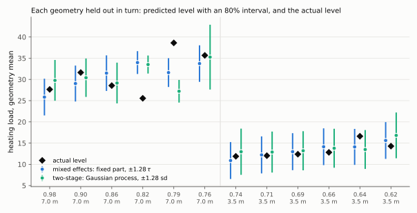

# 03 · The two models side by side

*Part of [models that use the grouping](README.md). It compares the [mixed-effects model](01-mixed-effects.md) and the [two-stage model](02-two-stage.md) as used in [`02_grouped_structure.ipynb`](../../02_grouped_structure.ipynb). Headline results are from the [results page](../results/02-grouped-structure.md); the per-fold quantities and the figure come from [`figures/make_figures.py`](figures/make_figures.py) and are saved in [`figures/numbers.json`](figures/numbers.json).*

The two previous notes describe two models that look different on the page: a single regression with a random intercept, fitted by restricted maximum likelihood, and a Gaussian process on eleven group means plus a lookup table. Underneath, they describe the same structure. Both say that a building's heating load is its geometry's level plus a shift for its glazing plus a small residual, and both say that the level of a new geometry is partly predictable from its shape and partly not. Their differences lie in how they predict the predictable part, how they describe the unpredictable part, and what that description is worth when it matters. Over the twelve geometries of the UCI Energy Efficiency table they end up with nearly the same accuracy, MAE 2.68 and 2.80, for different reasons on different geometries.

---

## 1. One structure, two descriptions

| | Mixed-effects model | Two-stage model |
|---|---|---|
| **Predictable part of a new geometry's level** | the fixed part: linear in compactness and height | a Gaussian process over the five shape columns, fitted to eleven geometry means |
| **Unpredictable part of the level** | the offset $u_g$, normal with variance $\tau^2$, independent of shape | the process's noise term, plus the uncertainty of the smooth function, which grows away from the context geometries |
| **Within-geometry part** | linear: glazing area, area times height, one indicator per glazing distribution, orientation | a table of average shifts, one per combination of height, glazing area and glazing distribution |
| **Design-level residual, standard deviation across folds** | $\sigma$ = 0.60 to 0.67 | 0.52 to 0.59 |
| **How it is fitted** | one joint fit on the 704 context designs | two separate fits: the process on eleven means, the table by averaging |
| **Uncertainty for a design of a new geometry** | $\tau^2 + \sigma^2$, the same for every geometry | the process's predictive variance plus the residual variance, different for every geometry |
| **After observing a few designs of the new geometry** | built in: the shrinkage estimate of the offset | not built in; the process could be refitted with the new geometry's partial mean |

Both models put almost all their error in the level. After subtracting each geometry's mean error, the remaining MAE, which measures how well the designs of one geometry are told apart, is 0.51 for the mixed model and 0.45 for the two-stage model. The whole contest is about placing a new geometry's level.

---

## 2. The level, geometry by geometry

Each geometry was held out in turn; the figure shows each model's predicted level for it with an 80% interval for the level alone, $\pm 1.2816 \tau$ for the mixed model and $\pm 1.2816$ times the process's predictive standard deviation for the two-stage model, and the geometry's actual level as a black diamond. The per-geometry MAE over all 64 designs is:

| Geometry | 0.98 / 7.0 m | 0.90 | 0.86 | 0.82 | 0.79 | 0.76 | 0.74 / 3.5 m | 0.71 | 0.69 | 0.66 | 0.64 | 0.62 |
|---|---|---|---|---|---|---|---|---|---|---|---|---|
| Mixed effects | **1.97** | 2.60 | 2.93 | 8.42 | **7.00** | 1.97 | **1.00** | **0.44** | **0.66** | 1.33 | **2.51** | **1.34** |
| Two-stage | 2.13 | **1.25** | **0.76** | **7.96** | 11.39 | **0.66** | 1.08 | 0.92 | 0.81 | **0.97** | 3.12 | 2.54 |

The mixed model has the lower error on seven geometries and the two-stage model on five. The pattern behind that count is clearer than the count.

**On the two-storey geometries whose levels follow their shape, the Gaussian process wins by a lot.** On the 0.90, 0.86 and 0.76 geometries the two-stage model's errors are 1.25, 0.76 and 0.66 against 2.60, 2.93 and 1.97. The two-storey levels do not change in a straight line with compactness: in compactness order they go 27.7, 31.6, 28.6, 25.6, 38.6 and 35.7. A straight line through them misses most of them by a few units, while the process, which uses wall area and can bend, follows the geometries that share their neighbours' pattern closely.

**On the one-storey geometries the straight line is good enough, and the simpler model is slightly better.** One-storey levels rise gently as compactness falls, from 11.9 at 0.74 to 12.8 at 0.66, and then to 16.6 and 14.3 for the last two geometries, a trend the mixed model's fixed part follows reasonably well. The process does no better on the first four and worse on the 0.64 and 0.62 geometries, whose levels break the gentle trend.

**On the pair that breaks the pattern, both fail, and the more flexible model fails harder on one of them.** The 0.82 geometry is predicted at 34.0 by the mixed model and 33.5 by the two-stage model against an actual 25.6. The 0.79 geometry is predicted at 31.6 and 27.2 against an actual 38.6: the mixed model's straight line at least points upwards from the 0.82 geometry towards the 0.76, while the process, whose kernel changed in that fold to rely on roof area, averaged the two other geometries with the same roof, 28.6 and 25.6. Flexibility helps where the pattern holds and costs where a few data points make the model choose the wrong pattern.

---

## 3. The within-geometry part

The lookup table is the more flexible description of the glazing effect. It makes no assumption that the effect is linear in glazing area, it lets every distribution have its own effect at every area and height, and it is estimated by plain averaging. The mixed model's formula assumes a jump for having windows at all, a slope in area that grows linearly with height, and distribution and orientation effects that are the same at every area. In this table both descriptions are nearly exact, and the difference, 0.45 against 0.51 in within-geometry MAE, is small beside the errors in the level.

The formula has one advantage the table lacks: it can predict a glazing setup that was never simulated, such as a 30% window area, by interpolating along its slope. The table has no entry for a cell it has not seen.

---

## 4. What their uncertainty is worth

Both models estimate a between-geometry spread, a number that says how far a geometry's level may sit from what its shape predicts. In the mixed model this is $\tau$, between 3.3 and 3.4 in most folds. In the two-stage model it appears as the Gaussian process's noise term, which, translated into heating-load units, is between 3.0 and 3.3 in the same folds. The two models arrive at almost the same number in different ways, because they are measuring the same thing: geometries such as the 0.90 and 0.82 pair, which look alike to the model and differ in level by six units.

The two models also share the same weakness. In the folds that hold out the 0.82 or the 0.79 geometry, that pair is broken up, the context looks more regular than the table really is, and both spreads shrink: $\tau$ to 2.10 and 2.65, the process's noise to 1.4 and 1.5, and its full predictive standard deviation to 1.65 and 2.09, the smallest of all twelve folds. Both bands are therefore narrowest for the two geometries they miss most, and both cover none of their designs. Overall, both bands cover 83% of all designs and at least 80% on ten of twelve geometries. A model's estimate of how surprising groups can be is learned from the groups it has seen, and when the most surprising group is the one held out, every model is told that groups are less surprising than they are.

Where the two differ is in what else the band responds to. The process's band also grows with distance from the context geometries: the function part of its standard deviation is 5.1 for the 0.76 geometry, whose wall area is far beyond the other two-storey geometries', against 0.9 to 1.9 for geometries surrounded by neighbours. The mixed model's band, as notebook 02 computes it, has the same width everywhere. Its predictive variance does contain a term that grows at the edges, the uncertainty of the fixed part, whose standard error is 3.8 for the most compact geometry and 2.6 for the 0.76 geometry against 1.0 to 1.8 inside the range, but the band leaves it out. With that term included, both models would say they are less sure at the edges: the process because the new shape is far from any known one, the linear model because a straight line fitted to twelve points is least certain at its ends. Neither can say anything about a jump between two neighbours that it has not seen.

---

## 5. A model that is both

The two models are special cases of one model. Keep the mixed model's equation, $y_{gi} = x_{gi}^\top \beta + u_g + \varepsilon_{gi}$, but let the offsets of different geometries be correlated according to how similar their shapes are:

$$
\mathrm{Cov}(u_g, u_h) = \tau_1^2 k(z_g, z_h) + \tau_0^2 \delta_{gh},
$$

where $z_g$ is geometry $g$'s vector of shape columns, $k$ is a kernel with value 1 for identical shapes and falling towards 0 as shapes differ, as in the [two-stage note](02-two-stage.md#gaussian-process-regression-briefly), $\tau_1^2$ is the variance of the part of the offset that is smooth in shape, $\tau_0^2$ is the variance of the part that is particular to each geometry, and $\delta_{gh}$ is 1 when $g = h$ and 0 otherwise.

- With $\tau_1^2 = 0$, the offsets are independent and this is the mixed model of the first note.
- With the fixed part reduced to an intercept and the within-geometry terms, the smooth part of the offset is a Gaussian process over shape and the geometry-specific part is its noise term; fitting the process to the geometry means and the within-geometry terms by averaging, separately, gives the two-stage model.

Fitted jointly, by restricted maximum likelihood over all designs, such a model would predict a new geometry's offset from its shape-neighbours' offsets, give a band that grows with distance from the known shapes, weight each geometry by how precisely its level is known, and update for a few observed designs of the new geometry through the same shrinkage as the mixed model. Libraries for grouped random effects with Gaussian-process components, such as GPBoost, fit models of this kind. It has not been tried on this table, and with eleven context geometries it would not be expected to anticipate the 0.82 and 0.79 jump either; its advantage would be one coherent account of the uncertainty rather than two partial ones.

---

## 6. Where TabPFN sits

TabPFN-3.5, given the same rows and no information about the grouping beyond the repeated shape columns, has an MAE of 2.92 averaged over three seeds, level with both models, and with no difference resolved over twelve geometries. It misses the same two geometries in the same directions, too high on the 0.82 and too low on the 0.79. Its 80% band, about 11 units wide on average, covers 82% of all designs, more than 80% on nine of twelve geometries, 44% of the 0.82 geometry and none of the 0.79.

That three approaches as different as a linear mixed model, a Gaussian process on group means and a pretrained in-context learner end up within 0.25 of each other, and fail on the same pair, says the limit is in the data, not in the model class. Eleven geometries do not contain the information needed to place the 0.82 and 0.79 levels. A single simulated design of the new geometry does: for the mixed model it brings the average error on a new geometry from 2.68 down to 0.72, as shown in the [first note](01-mixed-effects.md#9-after-observing-a-few-designs-of-the-new-geometry).

---

## 7. Choosing between them

- **Many groups, a group-level relation that is roughly linear, or a need for interpretable effects.** The mixed model. Its coefficients and their standard errors separate between-group effects from within-group effects correctly, and its $\tau$ and $\sigma$ say directly which comparisons are trustworthy: two designs of one new geometry differ by a standard deviation of 0.91 beyond their predicted difference, two designs of two new geometries by 4.63.
- **A group-level relation that is nonlinear but smooth, enough groups to learn a kernel, and balanced groups.** The two-stage model, or better the joint model of section 5. On geometries whose levels follow their shape, its errors were a quarter to a half of the mixed model's.
- **Small, unequal or unbalanced groups.** The mixed model or a joint model. The two-stage model's raw group means are noisy for small groups, mean different things for groups with different within-group designs, and enter the process unweighted.
- **Few groups, as here.** Neither model can be preferred on evidence: their difference in MAE, 0.12, is far smaller than the uncertainty twelve geometries leave, and the simultaneous intervals for TabPFN against each of the two models span more than three units. Report per-group errors, treat the bands as approximate, and if new groups matter, collect a few observations of each new group before trusting its level.
- **New rows inside a known group.** Both models are excellent, but so is any reasonable regression; the grouped structure is only a difficulty for new groups.

---

**Back to:** [models that use the grouping](README.md) · [the results ledger](../results/index.md)
